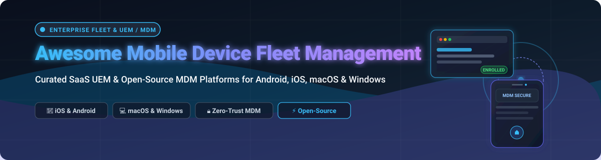

# Awesome Mobile Device Fleet Management 📱💻🛡️

  

  
  
  
  
  
  

---

> 🚀 **The definitive curated guide to Mobile Device Fleet Management (MDM), Unified Endpoint Management (UEM), and Enterprise Mobility Management (EMM).** Explore leading cloud SaaS enterprise solutions and production-ready open-source platforms for enrolling, provisioning, monitoring, securing, and wiping Android, iOS, iPadOS, macOS, Windows, and Linux fleets.
>
> 🌟 *Star this repository to stay up-to-date with emerging tools and trends!* 🌟

---

## 📑 Table of Contents

- [🌐 Sector Overview & Market Dynamics](#-sector-overview--market-dynamics)
- [🟦 SaaS / Hosted Commercial Platforms](#-saas--hosted-commercial-platforms)
- [🟩 Open-Source Software](#-open-source-software)
  - [1. Fleet](#1-fleet)
  - [2. MicroMDM](#2-micromdm)
  - [3. Zentral](#3-zentral)
  - [4. NanoMDM](#4-nanomdm)
  - [5. Headwind MDM](#5-headwind-mdm)
  - [6. Commandment](#6-commandment)
  - [7. Flyve MDM](#7-flyve-mdm)
  - [8. OpenUEM](#8-openuem)
  - [9. MDMesh](#9-mdmesh)
- [📊 Feature Comparison at a Glance](#-feature-comparison-at-a-glance)
- [🤝 Contributing](#-contributing)
- [💖 Support & Sponsorship](#-support--sponsorship)
- [📈 Star History](#-star-history)
- [📄 License](#-license)

---

## 🌐 Sector Overview & Market Dynamics

The global Unified Endpoint Management (UEM) and Mobile Device Management (MDM) market is estimated at **$14.8 billion in 2026** and projected to surpass **$38 billion by 2030**, growing at a rapid CAGR of ~21%. The sector exhibits **moderate concentration** with tier-1 enterprise mega-caps (Microsoft and Broadcom/VMware) commanding dominant corporate shares through bundled office suites, while specialized vendors (Jamf for pure Apple environments, Hexnode, Kandji, Miradore) and flexible open-source projects capture vital mid-market, privacy-centric, and developer-first segments.

---

## 🟦 SaaS / Hosted Commercial Platforms

Commercial cloud-hosted UEM and MDM suites sorted in descending order by company valuation / parent revenue scale.

| Platform | Company Scale (Revenue / Valuation) | Starting Pricing (Paid Tiers) | Free Tier / Trial Limits | Key Specialization & OS Scope |
|:---|:---|:---|:---|:---|
| **Microsoft Intune** | **$245B+ Annual Revenue** *(Microsoft Corp.)* | **$8.00** /user/month *(Intune Plan 1 standalone; or included in Microsoft 365 E3/E5/Business Premium)* | **30-day free trial** *(up to 25 user licenses)* | Default choice for Microsoft-centric organizations; cross-platform enrollment (Windows, macOS, iOS, Android, Linux) with native Entra ID conditional access and Zero Trust controls. |
| **VMware Workspace ONE** | **$51B+ Annual Revenue** *(Broadcom / Omnissa buyout at ~$4B)* | **$3.78** /device/month *(Standard Edition, billed annually)* | **30-day free trial** *(full feature evaluation up to 25 devices)* | Enterprise-grade unified endpoint management with strict distinction between Enterprise Wipe (business data container) and Full Device Factory Reset. |
| **Jamf Pro** | **~$600M Annual Revenue / $2.3B Public Valuation** *(NASDAQ: JAMF)* | **$4.33** /device/month *(iOS/iPadOS/tvOS; macOS starting at $8.25/device/month)* | **14-day free trial** *(full functional access; Jamf Now also offers first 3 devices free forever)* | The enterprise gold standard for Apple fleet deployments, supporting Apple Business Manager (ABM), zero-touch Mac provisioning, configuration profiles, and FileVault keys. |
| **Kandji** | **$850M+ Private Valuation** *(Series C funded)* | **$4.00** /device/month *(billed annually, 100-device enterprise minimum commitment)* | **14-day free trial** *(available upon guided sales qualification)* | Next-gen Apple device management focusing on automated compliance blueprints, custom shell scripting, and Zero-Touch macOS/iOS provisioning. |
| **Hexnode UEM** | **~$100M+ Valuation** *(Mitsogo Inc.)* | **$1.08** /device/month *(Hexnode Express tier, billed annually)* | **14-day free trial** *(fully featured unlimited device evaluation)* | Intuitive mid-market cross-platform management across Android, iOS, iPadOS, macOS, Windows, and tvOS with advanced kiosk lockdown features. |
| **Miradore** | **Mid-Market Scale** *(Acquired by Syncro MSP)* | **$2.00** /device/month *(Miradore Plus tier, billed annually)* | **Free forever plan** *(strictly limited to 50 active devices; 14-day free trial for Premium features)* | Cost-effective SMB fleet manager covering basic remote inventory, security profiles, and passcodes for Android, iOS, Windows, and macOS. |

---

## 🟩 Open-Source Software

Self-hosted, transparent, and community-driven mobile fleet and endpoint management software.

> **Sorted in descending order by GitHub Stargazer Count.** Each badge links directly to the project's stargazers community.

### 1. Fleet

- **Repository:** [fleetdm/fleet](https://github.com/fleetdm/fleet)
- **Tech Stack:** Go 🐹 • React ⚛️ • MySQL 🐬 • Redis ⚡
- **License:** Open Source / MIT Core
- **Supported Platforms:** macOS 🍎, iOS 📱, Windows 🪟, Android 🤖, Linux 🐧, Chromebooks 💻
- **Why It Stands Out:**
  - Production-scale device management deployed across fleets exceeding **400,000+ devices**.
  - **GitOps-Native:** Entire fleet configuration lives in declarative YAML files reviewed via GitHub Pull Requests.
  - Comprehensive live osquery telemetry, CVE vulnerability tracking, software package deployment, and disk encryption key escrow.

---

### 2. MicroMDM

- **Repository:** [micromdm/micromdm](https://github.com/micromdm/micromdm)
- **Tech Stack:** Go 🐹
- **License:** MIT License
- **Supported Platforms:** macOS 🍏, iOS 📱, iPadOS, tvOS
- **Why It Stands Out:**
  - The pioneering open-source Apple MDM server protocol implementation.
  - Native integration with Apple Push Notification service (APNs), Apple Automated Device Enrollment (DEP/ADE), and Volume Purchase Program (VPP).
  - Designed as Unix-philosophy composable microservices for Apple enterprise deployments.

---

### 3. Zentral

- **Repository:** [zentralopensource/zentral](https://github.com/zentralopensource/zentral)
- **Tech Stack:** Python 🐍 • Django • PostgreSQL 🐘 • Elasticsearch / OpenSearch
- **License:** Apache-2.0
- **Supported Platforms:** macOS 🍎, iOS 📱, Linux 🐧
- **Why It Stands Out:**
  - Combines Apple MDM configuration profiles with real-time event aggregation and endpoint telemetry.
  - Native support for Osquery, Santa binary authorization, Munki software management, and Jamf Pro webhooks.
  - GitOps and Terraform-driven desired state enforcement for zero-trust security postures.

---

### 4. NanoMDM

- **Repository:** [micromdm/nanomdm](https://github.com/micromdm/nanomdm)
- **Tech Stack:** Go 🐹 • MySQL 🐬 • PostgreSQL 🐘
- **License:** MIT License
- **Supported Platforms:** iOS 📱, macOS 🍎, iPadOS
- **Why It Stands Out:**
  - Ultra-lightweight, high-throughput minimalist Apple MDM server core.
  - Stateless architecture capable of horizontal scaling and multi-tenant APNs command queuing.
  - Provides modular building blocks for teams building dedicated proprietary Apple device management infrastructure.

---

### 5. Headwind MDM

- **Repository:** [h-mdm/hmdm-server](https://github.com/h-mdm/hmdm-server)
- **Tech Stack:** Java ☕ • PostgreSQL 🐘 • Android AOSP 🤖
- **License:** Apache-2.0
- **Supported Platforms:** Android 🤖 *(Corporate Dedicated & COSU)*
- **Why It Stands Out:**
  - Battle-tested dedicated Android Enterprise management system with QR code provisioning.
  - Silent Over-the-Air (OTA) APK installation, whitelist/blacklist application controls, and GPS tracking.
  - Turnkey Docker Compose installation with custom kiosk launcher shell.

---

### 6. Commandment

- **Repository:** [cmdmnt/commandment](https://github.com/cmdmnt/commandment)
- **Tech Stack:** Python 🐍 • Flask • SQLAlchemy
- **License:** MIT License
- **Supported Platforms:** macOS 🍏, iOS 📱
- **Why It Stands Out:**
  - Fully featured Python-based Apple MDM server supporting Apple Device Enrollment Program (DEP).
  - Push certificate generation, SCEP identity provisioning, and remote lock/wipe execution.
  - Clean web user interface for inspecting enrolled payloads and device inventories.

---

### 7. Flyve MDM

- **Repository:** [flyve-mdm/android-mdm-agent](https://github.com/flyve-mdm/android-mdm-agent)
- **Tech Stack:** Java ☕ • Kotlin • GLPI Plugin 🔌
- **License:** GPL-3.0
- **Supported Platforms:** Android 🤖
- **Why It Stands Out:**
  - Native integration with GLPI IT Asset Management system.
  - Device owner QR enrollment, hardware inventory capture, and remote password policy enforcement.

---

### 8. OpenUEM

- **Repository:** [open-uem/openuem-console](https://github.com/open-uem/openuem-console)
- **Tech Stack:** Go 🐹 • NATS 📨 • Svelte / Web Console
- **License:** Apache-2.0
- **Supported Platforms:** Windows 🪟, Linux 🐧, macOS 🍎
- **Why It Stands Out:**
  - Cross-platform unified endpoint manager with built-in remote desktop assistance via VNC.
  - Automated package management via Winget integration and granular local user/group profile enforcement.
  - Lightweight Go microservice backend built on NATS messaging.

---

### 9. MDMesh

- **Repository:** [MDMesh-app/MDMesh](https://github.com/MDMesh-app/MDMesh)
- **Tech Stack:** Java ☕ • Kotlin • React ⚛️ • PostgreSQL 🐘
- **License:** Apache-2.0
- **Supported Platforms:** Android 🤖
- **Why It Stands Out:**
  - Modern, zero-commercial-tier Android MDM built with a contemporary React dashboard.
  - Instant Device Owner QR onboarding, SHA-256 verified APK deployments, and pin-protected kiosk lockdown.
  - Cryptographically signed auto-updates with health-check rollbacks and canary deployment rings.

---

## 📊 Feature Comparison at a Glance

| Software | Model & License | Target Platforms | Zero-Touch Onboarding | Remote Wipe / Lock | Kiosk Mode | GitOps / API Automation | Ideal Use Case |
|:---|:---|:---|:---:|:---:|:---:|:---:|:---|
| **Microsoft Intune** | Commercial SaaS | Win / Mac / iOS / Android / Linux | ✅ | ✅ *(Full + Selective)* | ✅ | ✅ *(Graph API)* | Enterprises standardized on Microsoft 365 & Entra ID |
| **Workspace ONE** | Commercial SaaS | Win / Mac / iOS / Android / Rugged | ✅ | ✅ *(Enterprise + Factory)* | ✅ | ✅ *(REST API)* | Large-scale multi-OS enterprises needing deep wipe control |
| **Jamf Pro** | Commercial SaaS | macOS / iOS / iPadOS / tvOS | ✅ | ✅ *(Apple Native)* | ✅ | ✅ *(REST API)* | Organizations with primary or massive Apple footprints |
| **Kandji** | Commercial SaaS | macOS / iOS / iPadOS / tvOS | ✅ | ✅ *(Apple Native)* | ✅ | ✅ *(API + CLI)* | Modern Apple-first companies prioritizing automated compliance |
| **Hexnode UEM** | Commercial SaaS | Android / iOS / Win / Mac / tvOS | ✅ | ✅ | ✅ | ✅ | Mid-market businesses wanting easy multi-OS management |
| **Miradore** | Freemium SaaS | Android / iOS / Win / Mac | ✅ | ✅ | ⚠️ *(Paid)* | ✅ | Small teams needing up to 50 free enrolled devices |
| **Fleet** | Open Source (MIT) | Mac / Win / Linux / Android / iOS | ✅ | ✅ | ⚠️ | ✅ *(YAML GitOps)* | Engineering-driven teams wanting unified multi-OS GitOps |
| **MicroMDM** | Open Source (MIT) | macOS / iOS / tvOS | ✅ *(DEP)* | ✅ | ❌ | ✅ *(API First)* | Custom Apple MDM infrastructure builders & DevOps |
| **Zentral** | Open Source (Apache-2) | macOS / iOS / Linux | ✅ | ✅ | ❌ | ✅ *(Terraform)* | Security and observability teams running Apple fleets |
| **NanoMDM** | Open Source (MIT) | macOS / iOS | ✅ | ✅ | ❌ | ✅ *(API)* | High-throughput, stateless microservice Apple MDM |
| **Headwind MDM** | Open Source (Apache-2) | Android Dedicated | ✅ *(QR)* | ✅ | ✅ | ✅ *(REST API)* | Self-hosted Android kiosks, logistics tablets, and terminals |
| **Commandment** | Open Source (MIT) | macOS / iOS | ✅ *(DEP)* | ✅ | ❌ | ✅ | Python developers seeking self-hosted Apple device control |
| **Flyve MDM** | Open Source (GPL-3) | Android | ✅ | ✅ | ❌ | ✅ | Teams managing hardware and mobile assets in GLPI |
| **OpenUEM** | Open Source (Apache-2) | Windows / Linux / macOS | ❌ | ✅ *(Power/Reboot)* | ❌ | ✅ | Sysadmins managing corporate workstations with remote VNC |
| **MDMesh** | Open Source (Apache-2) | Android | ✅ *(QR)* | ✅ | ✅ | ✅ | Modern self-hosted Android kiosk and dedicated fleets |

---

## 🤝 Contributing

Contributions, issues, and feature additions are always welcome! 

1. Fork the Project.
2. Create your Feature Branch (`git checkout -b feature/NewTool`).
3. Commit your Changes (`git commit -m "Add new open-source MDM tool"`).
4. Push to the Branch (`git push origin feature/NewTool`).
5. Open a Pull Request.

Please ensure that newly submitted open-source software is actively maintained, contains clear licensing terms, and targets mobile device fleet management or unified endpoint security.

---

## 💖 Support & Sponsorship

If this curated repository saved you research time or assisted in choosing the right MDM/UEM solution for your organization, please consider supporting the project:

- ⭐ **Star this repository** to help others discover it.
- 🍴 **Fork and contribute** your own insights or tools.
- 📢 **Share with fellow sysadmins, DevOps, and SecOps engineers.**
- ☕ **Buy me a coffee / Sponsor:** Support ongoing maintenance via the [GitHub Sponsors Dashboard](https://github.com/sponsors/ishandutta2007).

---

## 📈 Star History

---

## 📄 License

This repository and curated list are released under the [Creative Commons Zero v1.0 Universal](https://creativecommons.org/publicdomain/zero/1.0/) (CC0 1.0 - Public Domain Dedication). All referenced software, trademarks, and brand names belong to their respective copyright holders.
